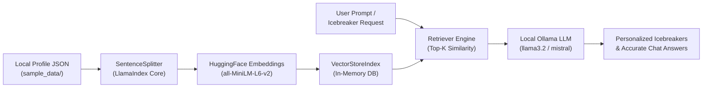

# 🧊 LinkedIn Icebreaker Bot (Local Ollama Edition)

[](https://www.python.org/downloads/)
[](https://ollama.ai)
[](https://www.llamaindex.ai)
[](https://huggingface.co/sentence-transformers/all-MiniLM-L6-v2)
[](https://gradio.app)
[](LICENSE)

An intelligent, 100% private conversational bot that generates tailored conversation starters, highlights key career achievements, and answers deep in-context questions about LinkedIn profiles. 

Originally built around IBM watsonx.ai and external APIs, this refined edition runs **completely offline and locally** powered by **Ollama**, **HuggingFace sentence-transformers**, and **LlamaIndex** — **zero cloud API keys required**.

> 📄 **Academic / Submission Report:** Check out the complete [Project Report](PROJECT_REPORT.md) covering architecture, methodology, benchmarks, and engineering solutions.

---

## 🌟 Key Highlights

- 🔒 **100% Offline & Private**: Zero profile data or prompts ever leave your machine.
- 💰 **Zero API Costs**: No OpenAI, watsonx, or ProxyCurl credits required.
- ⚡ **Local RAG Pipeline**: Uses `all-MiniLM-L6-v2` embeddings and vector search in memory.
- 👥 **Curated AI Leaders Dataset**: Pre-loaded with rich, realistic structured profiles (Jensen Huang, Satya Nadella, Sam Altman, Andrej Karpathy, Sir Demis Hassabis, Dr. Fei-Fei Li, and more).
- 🎨 **Modern Interactive Web UI**: Polished Gradio interface with one-click icebreaker generation and interactive chat with quick-prompt shortcuts.
- 💻 **Versatile CLI**: Headless command-line mode for quick terminal inspections and automation.

---

## 🏗️ Architecture



---

## 🔄 What Changed From the Original IBM Stack

| Component | Original Starter (IBM Cloud) | Local Ollama Edition |
|---|---|---|
| **LLM Inference** | IBM watsonx.ai (`ibm/granite`) | **Local Ollama** (`llama3.2`, `mistral`, etc.) |
| **Embeddings** | IBM Slate Retriever | **HuggingFace** `all-MiniLM-L6-v2` |
| **Profile Ingestion** | ProxyCurl API ($$$ / limited) | **Local structured JSON store** (easily extensible) |
| **Cloud Dependency** | Mandatory internet & IBM credentials | **Completely offline / self-contained** |
| **Compatibility** | Python 3.10/3.11 with strict IBM SDKs | Clean modern dependencies with locked `ollama<0.4.0` |

---

## 👥 Included Sample Profiles

| Profile Key | Public Name | Role / Current Occupation |
|---|---|---|
| `satya_nadella` | **Satya Nadella** | Chairman & CEO at Microsoft |
| `jensen_huang` | **Jensen Huang** | Founder, President & CEO at NVIDIA |
| `sam_altman` | **Sam Altman** | CEO at OpenAI, Former President YC |
| `andrej_karpathy` | **Andrej Karpathy** | Founder at Eureka Labs, Former Director of AI at Tesla |
| `demis_hassabis` | **Sir Demis Hassabis** | CEO at Google DeepMind, 2024 Nobel Laureate in Chemistry |
| `feifei_li` | **Dr. Fei-Fei Li** | Professor at Stanford University, Creator of ImageNet |
| `leonkatsnelson` | **Leon Katsnelson** | CTO at TechEd Solutions, Former IBM Distinguished Engineer |
| `sample_data_scientist` | **Priya Sharma** | Senior Data Scientist at Google |

---

## 🚀 Quickstart Guide

### Prerequisites
1. **Python 3.11+** installed.
2. **Ollama** installed on your system ([Download Ollama](https://ollama.ai/download)).

### Step 1: Pull an Ollama Model
In your terminal, pull your preferred local model:
```bash
ollama pull llama3.2
```
*(You can also use `mistral`, `gemma2`, or any other model already in your Ollama library).*

### Step 2: Set Up Virtual Environment & Dependencies
```bash
# Navigate to project folder
cd icebreaker

# Create virtual environment
python -m venv venv

# Activate virtual environment
# Windows PowerShell:
.\venv\Scripts\Activate.ps1
# Linux / macOS:
source venv/bin/activate

# Install dependencies
pip install -r requirements.txt
```

---

## 🖥️ Usage

### Option 1: Web Interface (Gradio)
Launch the interactive web portal:
```bash
python app.py
```
Open **`http://127.0.0.1:5000`** in your browser.

- **Tab 1 — Profile Intelligence**: Select a profile from the dropdown, review the model, and click **`⚡ Generate Icebreakers`**.
- **Tab 2 — Interactive Profile Chat**: Ask in-depth questions or click one of the quick prompt buttons (*"Draft a cold outreach LinkedIn message"*, *"What are their biggest achievements?"*).

---

### Option 2: Command-Line Interface (CLI)
View all available profiles:
```bash
python main.py --list
```

Run with an interactive terminal session:
```bash
# Run with Jensen Huang
python main.py --profile jensen_huang

# Run with custom model
python main.py --profile sam_altman --model mistral
```

---

## 📁 Project Structure

```
icebreaker/
├── app.py                     # Polished Gradio web interface with quick prompts
├── main.py                    # Interactive CLI runner
├── config.py                  # Model parameters, templates & profile labels
├── requirements.txt           # Cleaned and pinned dependencies
├── .gitignore                 # Excludes venv, models, caches
├── sample_data/
│   └── linkedin_profiles.json # Rich dataset of tech leaders & data scientists
└── modules/
    ├── __init__.py            # Exported module definitions
    ├── data_extraction.py     # Local JSON profile loader & fuzzy matcher
    ├── data_processing.py     # LlamaIndex chunking & vector indexing
    ├── llm_interface.py       # Ollama LLM client & HuggingFace embedder
    └── query_engine.py        # RAG prompt construction & query resolution
```

---

## ➕ Adding Custom Profiles

To add your own profile or colleague's data, simply open `sample_data/linkedin_profiles.json` and append a new JSON object:

```json
"your_username": {
  "public_identifier": "your_username",
  "first_name": "Alex",
  "last_name": "Smith",
  "full_name": "Alex Smith",
  "headline": "Lead AI Engineer | Open Source Contributor",
  "summary": "Passionate about autonomous agent architectures...",
  "city": "San Francisco",
  "country_full_name": "United States",
  "experiences": [
    {
      "company": "NextGen AI",
      "title": "Principal Engineer",
      "description": "Building RAG systems..."
    }
  ],
  "education": [
    {
      "school": "University of Waterloo",
      "degree_name": "B.S. in Computer Science"
    }
  ],
  "skills": ["Python", "PyTorch", "LlamaIndex", "Ollama"]
}
```
The new profile will immediately appear in the dropdown and CLI!

---

## 🛠️ Configuration & Environment Variables

| Variable | Default | Description |
|---|---|---|
| `OLLAMA_BASE_URL` | `http://localhost:11434` | Ollama daemon endpoint |
| `OLLAMA_MODEL` | `llama3.2` | Default LLM model identifier |

---

## 🤝 Troubleshooting

<details>
<summary><b>1. ChatResponse object has no field "usage"</b></summary>
Ensure <code>ollama&lt;0.4.0</code> is installed (e.g. <code>ollama==0.3.3</code>). This is already locked in <code>requirements.txt</code> to avoid breaking schema changes between LlamaIndex's Ollama adapter and newer Ollama Python SDKs.
</details>

<details>
<summary><b>2. UnicodeEncodeError on Windows Command Prompt</b></summary>
Both <code>main.py</code> and <code>app.py</code> wrap <code>sys.stdout</code> and <code>sys.stderr</code> with UTF-8 encoding automatically to guarantee emojis render without crashing Windows <code>cp1252</code> terminals.
</details>

---

## 📄 License
This project is open-source under the [MIT License](LICENSE).

## 🙌 Acknowledgments
- Inspired by the original IBM watsonx.ai icebreaker starter template.
- Built with [LlamaIndex](https://www.llamaindex.ai/) & [Ollama](https://ollama.ai/).
- Powered by [HuggingFace Transformers](https://huggingface.co/).
